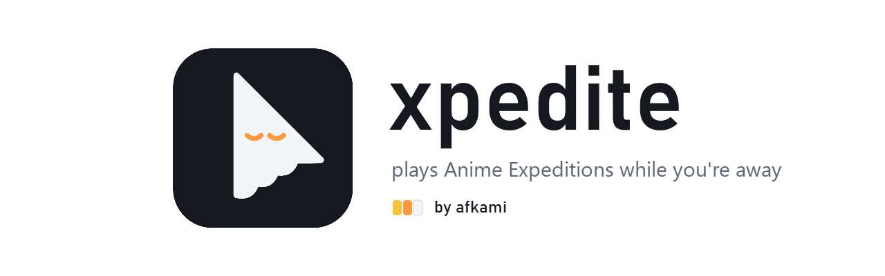
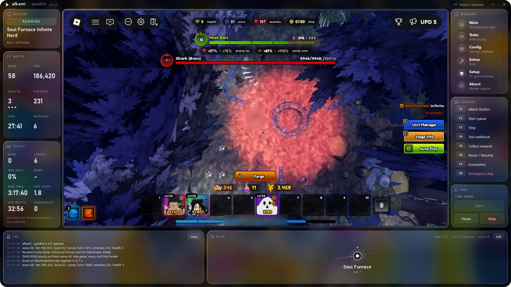
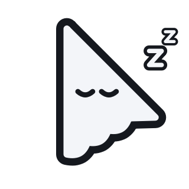
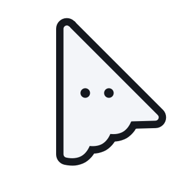
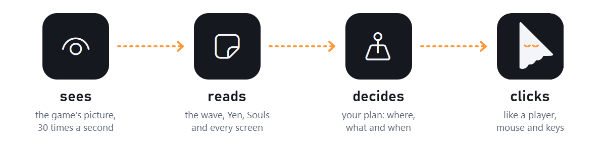

<div align="center">

<picture>
  <source media="(prefers-color-scheme: dark)" srcset="docs/art/hero_dark.png">
  <source media="(prefers-color-scheme: light)" srcset="docs/art/hero_light.png">
  
</picture>

<sub><i>xpedite</i> &nbsp;/ˈɛkspədaɪt/ &nbsp;&nbsp;·&nbsp;&nbsp; <i>afkami</i> &nbsp;/æfˈkɑːmi/, an AFK spirit that clicks for you</sub>

<br><br>


<br><br>

**xpedite** is the [afkami](https://github.com/afkamihq) macro for the Roblox game **Anime Expeditions**: a free, open-source macro that plays the way a player does, by looking at the screen and using the mouse and keyboard.

<h6>
  <a href="#what-it-plays">what it plays</a> &nbsp;·&nbsp;
  <a href="#how-it-works">how it works</a> &nbsp;·&nbsp;
  <a href="#install">install</a> &nbsp;·&nbsp;
  <a href="#license">license</a>
</h6>

<picture>
  <source media="(prefers-color-scheme: dark)" srcset="docs/art/divider_dark.png">
  
</picture>

<br><br>



<br><br>

<table>
  <tr>
    <td align="center" width="33%">
      <br>
      <b>Farms while you sleep</b><br>
      <sub>Soul Furnace for hours on end: 1,500 to 2,200 Candy Corn a run, one run after another.</sub>
    </td>
    <td align="center" width="33%">
      <br>
      <b>Picks itself back up</b><br>
      <sub>Disconnects, a frozen Roblox, a screen it didn't expect: it reconnects, restarts and carries on.</sub>
    </td>
    <td align="center" width="33%">
      <br>
      <b>Knows when to stop</b><br>
      <sub>Stop at a time or a Candy Corn total, and shut the PC down after if you like.</sub>
    </td>
  </tr>
</table>

</div>

<br>

## What it plays

| | Mode | |
|:-:|---|---|
|  | **Soul Furnace** <sub>Halloween event · Infinite · Hard</sub> | Phantoms placed before the start, Auto Upgrade and priorities on every card, SPA boosts, Unbound Tomes, Random Units, DMG/RNG for the late game |
|  | **Expeditions** <sub>4 maps · difficulty 1-3</sub> | Rerolls until the route carries your minimum of the map's material and Fuel Cells, puts units on the payload's tail, Auto Upgrade with farms first, Anvils and Unbound/Investor tomes at the shop, hires, encounters, and extracts when the rest of the route falls short |
|  | **Story** <sub>Normal</sub> | School Grounds act 1; Crimson Shore and Flaming Monastery acts 1 to 5 |
|  | **Trick or Treat** | The lobby's doors, and the Tricks with your team |
|  | **Challenges** | Takes the offer it has a plan for, Trait Crystals first |
|  | **Sandbox** | Try any plan before using it for real |

Every strategy is a setting, not code. You draw your placements on a picture of each map in **Main** (for Expeditions, a picture of the payload), and the Soul Furnace plan and each Expedition map's minimums live in **Tasks**. Your team is a preset, so any team works.

## How it works

<div align="center">
<picture>
  <source media="(prefers-color-scheme: dark)" srcset="docs/art/how_dark.png">
  
</picture>
</div>

It never reads or changes Roblox's memory, and it never spends Robux, gems or anything you can't earn back in a match. The game's staff allow macros.

<details>
<summary><b>Also in the box</b></summary>
<br>

- A liquid-glass window with the game docked in the middle, the run's numbers and a log.
- A supervisor that starts the session again a minute after an error, and refreshes Roblox every hour so it stays quick.
- An optional Discord bot you create yourself: its status line shows the wave and Candy Corn live, and it has a panel with buttons, screenshots, a farm summary every few hours, and a ping when the farm needs you. A plain webhook works too.
- Runs in a second Windows account over Remote Desktop, so your PC stays free to use.

</details>

## Install

You need Windows 10 or 11, a screen of 1920 × 1080 or more (the game is docked at 1440 × 810) and Roblox signed in. Any frame-rate cap works, down to Roblox's lowest.

1. From [**Releases**](https://github.com/afkamihq/xpedite/releases/latest), download **`xpedite-<version>-windows.zip`**.
2. Unzip it anywhere (a folder of its own, not Program Files) and open **`xpedite.exe`**. No Python needed.
3. It **updates itself**: it looks for a new version when it opens and every few hours, and installs it when nothing is running (your settings, team and placements are kept). Turn that off in Config, or check by hand in About.

<details>
<summary>From the source instead</summary>

Download `xpedite-<version>-source.zip`, unzip it and run **`setup.bat`** once: it installs [uv](https://docs.astral.sh/uv/), Python 3.13 and the packages, then opens xpedite. After that, **`xpedite.bat`** opens it. By hand:

```bat
uv venv .venv-win --python 3.13
uv pip install --python .venv-win\Scripts\python.exe -r requirements.txt
xpedite.bat
```

</details>

The first start opens **Setup**: it checks your PC and the game's settings (xpedite plays at the game's lowest graphics, which every reference picture is taken at), reads your team, and its **Quick start** takes your private server link and adds an Expedition in three picks (map, difficulty, what to reroll for). Pick anything else in **Tasks** and press **Start**, or F2. F8 stops everything.

<details>
<summary><b>Farming in a second Windows account</b></summary>
<br>

Make a second local Windows account and connect to it with Remote Desktop, then run `scripts\farm.bat` there: xpedite opens, starts the queue as soon as Roblox is up, and starts again by itself after an error. Keep the Remote Desktop window open (minimized is fine). `scripts\make-shortcut.bat` puts a shortcut for it on that account's desktop, and `scripts\preview.bat` opens a look-only copy of the app in your own account.

</details>

## License

GPL-3.0: use it, change it and share it, and keep what you share open too.

<br>

<div align="center">
<picture>
  <source media="(prefers-color-scheme: dark)" srcset="docs/art/divider_dark.png">
  
</picture>
<br>
<sub>made by <a href="https://github.com/afkamihq">afkami</a> · not affiliated with Roblox Corporation or Expeditions Entertainment</sub>
</div>
